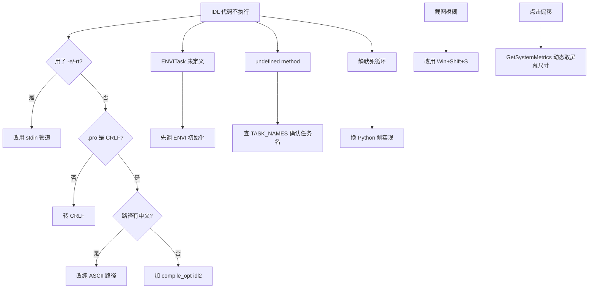

# ENVI / IDL 自动化

遥感影像处理软件的自动化操作指南。**本 skill 浓缩了实测踩坑，请勿重复试错。**

---

## 0. 三分钟速查（最高频问题）

| 症状 | 原因 | 解决 |
|---|---|---|
| `idl.exe -e` / `-rt` / `-q` 无效 | 参数被当成文件名 | **只用 stdin 管道**（见 §2） |
| `Variable is undefined: ENVITASK` | 没先初始化 ENVI | **必须先 `e = ENVI()`**（见 §3） |
| `undefined method: 'ENVI::NEWTASK'` | 用了 5.6 的 API | 6.2 改用 `ENVITask('...')`（见 §3） |
| `.pro` 报 Syntax error（位置诡异） | 文件是 LF 换行 | **必须 CRLF** |
| 中文路径编译失败 | IDL 不支持非 ASCII 字面量 | **路径全改纯 ASCII** |
| `quit` 挂起不退出 | 不是 IDL 命令 | 用 **`exit`** |
| 截图很糊 | 抓窗口DIB 后放大 | **用 Win+Shift+S**（见 §5） |
| 鼠标点击全偏移 | 硬编码了屏幕尺寸 | **`GetSystemMetrics()` 动态取** |

---

## 1. 环境探测（先做这步，不要凭假设）

```python
import os, glob

def find_envi():
    """定位 ENVI 安装目录，返回 (安装根, idl.exe 路径)"""
    cands = [
        r'C:\Program Files\NV5\ENVI62\IDL92\bin\bin.x86_64\idl.exe',
        r'C:\Program Files\Harris\ENVI56\IDL88\bin\bin.x86_64\idl.exe',
        r'C:\Program Files\NV5\ENVI55\IDL85\bin\bin.x86_64\idl.exe',
    ]
    # 再从磁盘扫
    for pat in [r'C:\Program Files\NV5\ENVI*\IDL*\bin\bin.x86_64\idl.exe',
                r'C:\Program Files\Harris\ENVI*\IDL*\bin\bin.x86_64\idl.exe']:
        cands += glob.glob(pat)
    for c in cands:
        if os.path.isfile(c):
            root = c.split('\\IDL')[0]
            return root, c
    raise FileNotFoundError('未找到 ENVI/IDL')

ROOT, IDL = find_envi()
print('ENVI root:', ROOT)

# 查许可
print(os.environ.get('IDL_LICENSE_PATH', '(未设置)'))
lic = os.path.join('C:\\', 'Program Files', 'NV5', 'license')
print('license dir:', os.path.isdir(lic))
```

**环境变量**：启动 ENVI/IDL 前设置 `IDL_LICENSE_PATH`，否则可能找不到许可文件。
```python
env = dict(os.environ)
env['IDL_LICENSE_PATH'] = r'C:\Program Files\NV5\license'
```

---

## 2. 执行 IDL 代码 —— 唯一可靠的方式

### ❌ 无效方式（不要再试）
```bash
idl.exe -e myproc          # 被当成文件名
idl.exe -rt myproc         # 不执行
idl.exe -q                 # 报 "Error opening file: -q"
startup.pro 自动执行        # IDL 9.2 不再自动调用
```

### ✅ 有效方式：stdin 管道
```python
import subprocess

def run_idl(proc_name, cwd, timeout=3600):
    """执行已编译的 IDL 过程"""
    p = subprocess.Popen(
        [IDL, ], cwd=cwd, stdin=subprocess.PIPE,
        stdout=subprocess.PIPE, stderr=subprocess.STDOUT)
    p.stdin.write(f'.compile {proc_name}\n'.encode())
    p.stdin.flush()
    import time; time.sleep(15)          # 等编译完成
    p.stdin.write(f'{proc_name}\n'.encode())
    p.stdin.flush()
    out, _ = p.communicate(timeout=timeout)
    return out.decode('gbk', errors='ignore')
```

### Bash 版本（调试用）
```bash
printf ".compile myproc\nexit\n" | "C:\Program Files\NV5\ENVI62\IDL92\bin\bin.x86_64\idl.exe"
```

### ⚠️ .pro 文件三铁律

```python
# 1) CRLF 换行 —— LF 会导致行尾截断式 Syntax error
data = open(p, 'rb').read()
data = data.replace(b'\r\n', b'\n').replace(b'\n', b'\r\n')
open(p, 'wb').write(data)

# 2) 纯 ASCII 路径 —— 中文会编译失败
#    把数据拷到 E:\work\ 之类纯 ASCII 目录
```

**日志句柄**：每个阶段单独 `openw` / `printf` / `free_lun`，否则报 `File is not open for output`。

---

## 3. ENVI 6.2 API（与 5.6 完全不同）

### 3.1 核心顺序：先 ENVI() 再 ENVITask()
```idl
pro my_task
  compile_opt idl2
  e = ENVI()                    ; ← 必须先初始化！
  raster = e.OpenRaster(srcPath)
  task = ENVITask('FXSegmentation')   ; ← 这样才可用
  ...
  task.Execute
  e.Close
end
```

### 3.2 API 变更对照

| 5.6 写法 | 6.2 实况 |
|---|---|
| `e.NewTask('Feature Extraction from Object Images')` | ❌ `undefined method: 'ENVI::NEWTASK'` |
| `fx.CreateSegmentationRule()` 等 rule 对象链式 | ❌ 全部 `undefined method` |
| `ENVITask('FXSegmentation')` | ✅ **但必须先 `ENVI()`** |

### 3.3 任务名查询（别猜，查表）
```idl
e = ENVI()
names = e.TASK_NAMES          ; 共 368+ 个
; 找出需要的任务名
idx = where(strpos(names, 'Segmentation') ge 0, -1)
print, names[idx]
```

**常用任务**：
- `FXSegmentation` — 面向对象分割+合并
- `RasterStatistics` — 栅格统计
- `ClassificationToShapefile` — 分类转矢量
- `RasterLayerThresholds` / `BinaryLTThresholdRaster` — 阈值
- `BandMath` — 波段运算
- `VectorMaskRaster` / `ClassificationToPolygonROI`

**扩展任务需另装**（GitHub `envi-idl/FXExtras`）：
`GetFXRasterStats` / `MaskFXRasterStats` / `RasterizeFXRasterStats`

### 3.4 FXSegmentation 完整示例
```idl
pro segment_task
  compile_opt idl2

  src = 'E:\work\data\sub_quac.hdr'
  seg = 'E:\work\seg.dat'

  if file_search(seg) ne '' then file_delete, seg   ; ENVI 拒绝覆盖已存在输出

  e = ENVI()
  raster = e.OpenRaster(src)

  task = ENVITask('FXSegmentation')
  task.INPUT_RASTER   = raster
  task.SEGMENT_ALGORITHM = 'Edge'              ; 或 'Quadtree'
  task.SEGMENT_VALUE  = 50.0                   ; 分割尺度
  task.SEGMENT_BANDS  = [6L]                   ; NIR1
  task.MERGE_ALGORITHM = 'Full Lambda Schedule'
  task.MERGE_VALUE    = 60.0                   ; 合并尺度
  task.MERGE_BANDS    = [6L]
  task.KERNEL_SIZE    = 3.0
  task.OUTPUT_RASTER_URI = seg

  task.Execute
  e.Close
end
```

参数清单（取自官方文档）：
`INPUT_RASTER` / `SEGMENT_ALGORITHM` / `SEGMENT_VALUE` / `SEGMENT_BANDS` /
`MERGE_ALGORITHM` / `MERGE_VALUE` / `MERGE_BANDS` / `KERNEL_SIZE` /
`OUTPUT_RASTER_URI` / `OUTPUT_MEANS_RASTER_URI`

> **不要读 task.TaskName 之类的属性** —— 会报 `-5`（属性不存在），不影响功能。

### 3.5 已知会死循环的任务
`BinaryLTThresholdRaster.Execute` 在无界面模式下**静默无限重试**（stdout 刷同一条几百次）。
若遇此情况：改用 Python/NumPy 直接读栅格算阈值 + 读分割结果做对象级聚合。

---

## 4. GUI 自动化（截图前的准备）

```python
import ctypes, time
from ctypes import wintypes

u = ctypes.windll.user32
EP = ctypes.WINFUNCTYPE(ctypes.c_bool, wintypes.HWND, wintypes.LPARAM)

def find_window(kw):
    """按标题关键词找可见窗口"""
    res = []
    def cb(h, l):
        if not u.IsWindowVisible(h): return True
        n = u.GetWindowTextLengthW(h)
        if n:
            b = ctypes.create_unicode_buffer(n+1)
            u.GetWindowTextW(h, b, n+1)
            if kw.lower() in b.value.lower():
                r = wintypes.RECT(); u.GetWindowRect(h, ctypes.byref(r))
                res.append((h, b.value, r.left, r.top,
                            r.right-r.left, r.bottom-r.top))
        return True
    u.EnumWindows(EP(cb), 0)
    res.sort(key=lambda x: -(x[4]*x[5]))
    return res[0] if res else None

SW = u.GetSystemMetrics(0)   # ⚠️ 必须动态取！别硬编码
SH = u.GetSystemMetrics(1)
```

**点击坐标**：屏幕 `1600×1000` 就用 1600×1000，不是 3200×2000。硬编码会让所有点击偏移一倍。

**置顶目标窗口**（截图前必做）：
```python
other = find_window('WorkBuddy')      # 或其他遮挡窗口
if other: u.ShowWindow(other[0], 6)  # SW_MINIMIZE
time.sleep(2)
w = find_window('ENVI')
u.ShowWindow(w[0], 3)                 # SW_MAXIMIZE
u.SetForegroundWindow(w[0]); u.BringWindowToTop(w[0])
u.SetWindowPos(w[0], -1, 0, 0, 0, 0, 0x0001 | 0x0002)   # TOPMOST
time.sleep(1.5)
```

**启动 GUI（分离进程，否则父进程退出连带被杀）**：
```python
DET = 0x00000008 | 0x00000200        # DETACHED_PROCESS | CREATE_NEW_PROCESS_GROUP
subprocess.Popen([gui_exe], cwd=ROOT, env=env,
                 creationflags=DET, stdin=DEVNULL,
                 stdout=DEVNULL, stderr=DEVNULL)
```

---

## 5. 截图 —— 用 Win+Shift+S，不要 PrintWindow

### 为什么不用 PrintWindow
`PrintWindow` 抓的是窗口 DIB，**报告的是逻辑尺寸**（如 562×510），
实际渲染受 DPI 缩放影响。强行放大必然模糊 + LANCZOS 伪影。
**Win+Shift+S 从屏幕合成器取图，拿到物理像素，天然清晰。**

### 完整自动化流程（已实测）
```python
import ctypes, time, subprocess
from ctypes import wintypes
from PIL import Image

u = ctypes.windll.user32
SW, SH = u.GetSystemMetrics(0), u.GetSystemMetrics(1)
ABS, MOVE, LD, LU = 0x8000, 0x0001, 0x0002, 0x0004

def kd(vk, down=True):
    u.keybd_event(vk, 0, 0 if down else 2, 0); time.sleep(0.04)
def tap(vk):
    kd(vk, True); time.sleep(0.05); kd(vk, False); time.sleep(0.1)
def win_shift_s():
    kd(0x5B)              # LWIN
    kd(0x10)              # SHIFT
    kd(0x53)              # S
    kd(0x53, False); kd(0x10, False); kd(0x5B, False)

def drag(x1, y1, x2, y2, steps=26):
    u.mouse_event(MOVE|ABS, int(x1*65535/SW), int(y1*65535/SH), 0, 0)
    time.sleep(0.12)
    u.mouse_event(LD, 0, 0, 0, 0); time.sleep(0.18)
    for i in range(1, steps+1):
        u.mouse_event(MOVE|ABS,
            int((x1+(x2-x1)*i/steps)*65535/SW),
            int((y1+(y2-y1)*i/steps)*65535/SH), 0, 0)
        time.sleep(0.022)
    time.sleep(0.2)
    u.mouse_event(LU, 0, 0, 0, 0); time.sleep(0.4)

def wait_snip_ui(timeout=8):
    """等截图覆盖层出现"""
    EP = ctypes.WINFUNCTYPE(ctypes.c_bool, wintypes.HWND, wintypes.LPARAM)
    t0 = time.time()
    while time.time() - t0 < timeout:
        hit = []
        def cb(h, l):
            if u.IsWindowVisible(h):
                n = u.GetWindowTextLengthW(h)
                if n:
                    b = ctypes.create_unicode_buffer(n+1)
                    u.GetWindowTextW(h, b, n+1)
                    if '截图工具覆盖' in b.value or 'Screen Snip' in b.value:
                        hit.append(h)
            return True
        u.EnumWindows(EP(cb), 0)
        if hit: return hit[0]
        time.sleep(0.35)
    return None

def save_clipboard_png(path):
    """剪贴板图像落盘 —— 必须用 PowerShell + System.Drawing"""
    ps = f'''
Add-Type -AssemblyName System.Windows.Forms, System.Drawing
$img = [System.Windows.Forms.Clipboard]::GetImage()
if ($img -eq $null) {{ Write-Output "EMPTY"; exit 1 }}
$img.Save("{path}", [System.Drawing.Imaging.ImageFormat]::Png)
Write-Output ("OK " + $img.Width + "x" + $img.Height)
'''
    r = subprocess.run(['powershell', '-NoProfile', '-STA', '-Command', ps],
                       capture_output=True, timeout=40)
    return r.stdout.decode('utf-8', errors='ignore').strip()

def snap(x1, y1, x2, y2, path):
    """完整截图流程"""
    win_shift_s(); time.sleep(1.3)
    if not wait_snip_ui(8):
        return None
    drag(x1, y1, x2, y2); time.sleep(0.9)
    tap(0x0D)                      # ENTER 落剪贴板
    time.sleep(2.0)
    msg = save_clipboard_png(path)
    return msg
```

### ⚠️ 关键细节
1. **输出目录必须先存在** —— 否则 PS 静默失败
2. **剪贴板读图像必须用 PowerShell** —— Python 的 `CF_DIB` + `GlobalLock` 在 64 位下拿不到（`GlobalSize` 返回 0）
3. **先最小化遮挡窗口**（WorkBuddy 等），再置顶目标窗口
4. 覆盖层窗口标题是 **「截图工具覆盖」**（中文系统）

实测输出：`snap(0,0,1600,1000, out)` → **3200×2000 原生像素**（HiDPI 屏幕）

---

## 6. 读取 ENVI 栅格（Python 侧）

```python
import numpy as np, os

def read_envi_band(dat_path, hdr_path, band_idx=1, dtype='<u2'):
    """读单个波段，band_idx 从 0 开始"""
    hdr = open(hdr_path, encoding='utf-8', errors='ignore').read()
    import re
    ns = int(re.search(r'samples\s*=\s*(\d+)', hdr).group(1))
    nl = int(re.search(r'lines\s*=\s*(\d+)', hdr).group(1))
    nb = int(re.search(r'bands\s*=\s*(\d+)', hdr).group(1))
    itemsize = np.dtype(dtype).itemsize
    with open(dat_path, 'rb') as f:
        f.seek(band_idx * ns * nl * itemsize)
        return np.fromfile(f, dtype=dtype, count=ns*nl).reshape(nl, ns)

def read_envi_meta(hdr_path):
    """读投影信息"""
    hdr = open(hdr_path, encoding='utf-8', errors='ignore').read()
    import re
    m = re.search(r'map info = \{(.*?)\}', hdr, re.S)
    if not m: return None
    p = [x.strip() for x in m.group(1).split(',')]
    return {'proj': p[0], 'units': p[-1],
            'pixel_size': (float(p[5]), float(p[6])),
            'ulx': float(p[2]), 'uly': float(p[3])}
```

**⚠️ 整数溢出坑**：波段是 uint16，直接算 `(a - b) / (a + b)` 会溢出。
```python
# ❌ 错
ndvi = (read_band(6) - read_band(4)) / (read_band(6) + read_band(4))
# ✅ 对
a = read_band(6).astype(np.float32); b = read_band(4).astype(np.float32)
ndvi = (a - b) / np.maximum(a + b, 1e-6)
```

---

## 7. 面向对象分类的完整配方

```python
import numpy as np
from scipy import ndimage

def classify_by_objects(seg, rule_mask, min_ratio=0.5, min_pixels=800):
    """按 ENVI FX 分割对象做纯度+面积过滤"""
    maxid = int(seg.max()) + 1
    total = np.bincount(seg.ravel(), minlength=maxid)
    hit   = np.bincount(seg[rule_mask].ravel(), minlength=maxid)
    ratio = hit / np.maximum(total, 1)
    ids = np.arange(1, maxid)
    keep = (ratio[ids] > min_ratio) & (total[ids] >= min_pixels) & (total[ids] > 0)
    kmask = np.zeros(maxid, dtype=bool)
    kmask[ids[keep]] = True
    return (kmask[seg] & rule_mask).astype(np.uint8), keep.sum()
```

**为什么必须做对象级过滤**：像元级规则在密集城区会因阴影、屋顶设备产生大量零碎误分；
按对象聚合后，保留"以目标地物为主且面积达标"的对象，结果稳健得多。

---

## 8. 制图规范（遥感专题图）

**四要素缺一不可**：图名 / 图例 / 指北针 / 比例尺

```python
def furniture(ax, km=0.5, nx=0.955, ny=0.925, XL=2.0):
    """指北针 + 比例尺"""
    ax.annotate('', xy=(nx, ny), xytext=(nx, ny+0.052),
                xycoords='axes fraction', textcoords='axes fraction',
                arrowprops=dict(arrowstyle='-|>', color='#1C1B1A', lw=2.0))
    ax.text(nx, ny+0.058, 'N', transform=ax.transAxes, ha='center',
            fontsize=15, fontweight='bold')
    w = km / XL
    x0, y = 0.055, 0.050
    ax.plot([x0, x0+w], [y, y], transform=ax.transAxes,
            color='#1C1B1A', lw=3.6, solid_capstyle='butt')
    for i in range(5):
        xx = x0 + w*i/4
        ax.plot([xx, xx], [y-0.013, y+0.013], transform=ax.transAxes,
                color='#1C1B1A', lw=1.6 if i in (0,4) else 0.9)
```

**Matplotlib 中文坑**：
```python
for f in ['Microsoft YaHei', 'SimHei']:
    if any(f.lower() in x.name.lower() for x in font_manager.fontManager.ttflist):
        plt.rcParams['font.sans-serif'] = [f]; break
plt.rcParams['axes.unicode_minus'] = False
# ❌ 不要用 family='DejaVu Sans Mono' —— 无中文字形，中文全变方块
```

**NDVI 色标方向**：绿色=植被（高值）、红色=建成区（低值）→ 用 `cmap='RdYlGn_r'`

**多子图 vs 多张单图**：三项内容要画成三张独立图（各 ≥11×9 英寸 @170dpi），
挤一张会导致字号过小、层次全糊。

---

## 9. 已验证的完整案例（城市地物提取）

| 环节 | 方法 | 结果 |
|---|---|---|
| 分割 | `FXSegmentation` Edge/50/FullLambda/60 | 182127 对象 |
| 像元规则 | NDVI<0.28 且 NDSI<0.13 | 2.699 km² |
| 对象过滤 | 纯度>50% 且 ≥800 像元(200m²) | 1318 对象，0.965 km² |
| 精度 | 14 个人工判读 ROI，混淆矩阵 | OA=0.7857, Kappa=0.3226 |
| 成果 | 分类栅格 + Shapefile + 专题图 | ✅ |

**同类传感器调参提示**：WorldView-2 有 NIR1(832nm) + NIR2(908nm) 两个近红外通道，
套用 Landsat 的 NDWI 公式会失效（46% 像元误判为水体），改用 NDSI。

---

## 10. 排查决策树



---

## 参考

- `references/troubleshooting.md` — 完整错误信息对照表
- `scripts/win_snip.py` — 截图模块（可直接 import）
- `scripts/gui_driver.py` — 窗口查找/点击/前置模块
- `scripts/example_pipeline.pro` — IDL 分割任务模板
